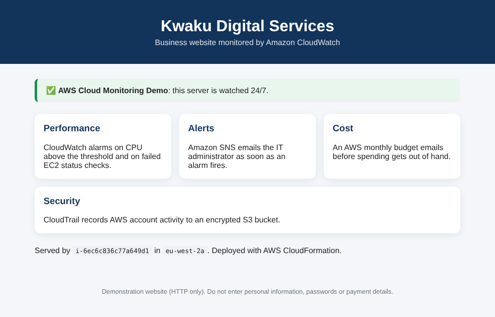

# AWS Cloud Monitoring, Security and Cost Optimisation Using CloudFormation

**Project 2 of my Cloud Engineer portfolio.** One **AWS CloudFormation** template deploys an EC2-hosted business website together with everything needed to watch it: **CloudWatch** alarms, **Amazon SNS** email alerts, an **AWS Budgets** monthly cost budget, and **AWS CloudTrail** auditing to **Amazon S3**.

| | |
|---|---|
| **Difficulty** | Beginner to Intermediate |
| **Deployment method** | AWS CloudFormation (Infrastructure as Code), via the Console **or** the AWS CLI |
| **Region** | Europe (London), `eu-west-2` |
| **Template** | [`cloudformation/kwaku-monitoring.yaml`](cloudformation/kwaku-monitoring.yaml): 9 AWS resources |
| **Stack name** | `kwaku-cloud-monitoring` |



---

## 1. The business problem

**Kwaku Digital Services** hosts its business website on Amazon EC2. The IT team has four problems:

| # | Problem | Impact |
|---|---------|--------|
| 1 | **Server performance**: the website sometimes becomes slow because CPU usage increases, and nobody knows when it happens | Poor customer experience |
| 2 | **Lack of monitoring**: if the EC2 instance develops a problem, engineers may not find out quickly | Long, unnoticed outages |
| 3 | **Unexpected AWS bills**: cloud spending is not tracked | Budget overruns discovered too late |
| 4 | **Limited security visibility**: no record of who changed what in the AWS account | Changes and incidents cannot be investigated |

**My responsibility as a Cloud Engineer:** design and deploy an AWS solution that

- monitors EC2 CPU utilisation,
- sends an email alert when CPU usage becomes too high,
- notifies administrators when the EC2 instance fails a status check,
- creates an AWS monthly budget with spending alerts,
- enables auditing of AWS management activity, and
- uses **CloudFormation** to deploy all of it automatically and repeatably.

**Expected business outcome:** the company gains visibility into server health, receives early warnings, tracks spending, and can investigate important account activity.

## 2. Architecture

```
                         ┌───────────────────────────────┐
                         │  AWS CloudFormation           │
                         │  kwaku-monitoring.yaml        │  one template → 9 resources
                         └───────────────┬───────────────┘
            ┌────────────────────────────┼────────────────────────────┐
            ▼                            ▼                            ▼
 ┌─────────────────────┐   ┌──────────────────────────┐   ┌──────────────────────┐
 │ EC2 instance        │   │ CloudWatch               │   │ AWS Budgets          │
 │ business website    │──►│ CPU > 60% (2 × 5 min)    │   │ $10 / month          │
 │ NGINX, port 80      │   │ status check failed      │   │ actual > 80% ($8)    │
 │ + security group    │   │ (2 × 1 min)              │   │ forecast > 100%      │
 └─────────────────────┘   └────────────┬─────────────┘   └──────────┬───────────┘
                                        ▼                            │
                           ┌──────────────────────────┐              │
                           │ Amazon SNS               │              │
                           │ kwaku-monitoring-alerts  │              │
                           └────────────┬─────────────┘              │
                                        ▼                            ▼
                           ┌──────────────────────────────────────────────┐
                           │ IT administrator: email alerts                │
                           └──────────────────────────────────────────────┘

 ┌──────────────────────────────────────────────────────────────────────────────┐
 │ CloudTrail trail kwaku-monitoring-trail ──► S3 audit bucket (encrypted,      │
 │ AWS management activity                      private, 90-day lifecycle)       │
 └──────────────────────────────────────────────────────────────────────────────┘
```

## 3. AWS services used

| AWS service | Purpose |
|-------------|---------|
| **CloudFormation** | Deploys every resource from one YAML template |
| **EC2** (+ security group) | Hosts the demonstration business website (HTTP only, no SSH) |
| **CloudWatch** | CPU utilisation alarm and status-check alarm |
| **SNS** | Sends email notifications to the administrator |
| **AWS Budgets** | Emails when monthly spending reaches the threshold |
| **CloudTrail** | Records AWS management API activity |
| **S3** | Stores the CloudTrail audit logs (encrypted, public access blocked) |

### The 9 resources in the template

| # | Logical ID | Type | What it does |
|---|-----------|------|--------------|
| 1 | `WebSecurityGroup` | `AWS::EC2::SecurityGroup` | HTTP 80 in; **no SSH** |
| 2 | `WebServer` | `AWS::EC2::Instance` | Amazon Linux 2023 in the default VPC; user data installs NGINX and the website |
| 3 | `AlertTopic` | `AWS::SNS::Topic` | `kwaku-monitoring-alerts`, with an email subscription to `AlertEmail` |
| 4 | `CpuAlarm` | `AWS::CloudWatch::Alarm` | Average `CPUUtilization` > 60% for 2 consecutive 5-minute periods |
| 5 | `StatusCheckAlarm` | `AWS::CloudWatch::Alarm` | `StatusCheckFailed` ≥ 1 for 2 consecutive 1-minute periods |
| 6 | `MonthlyBudget` | `AWS::Budgets::Budget` | $10/month; email at 80% actual and at 100% forecasted |
| 7 | `AuditBucket` | `AWS::S3::Bucket` | Encrypted, all public access blocked, logs expire after 90 days |
| 8 | `AuditBucketPolicy` | `AWS::S3::BucketPolicy` | Only *this* trail may write; HTTPS-only access |
| 9 | `AuditTrail` | `AWS::CloudTrail::Trail` | `kwaku-monitoring-trail`, log file validation on |

Both alarms send **ALARM and OK** notifications, so you also hear when a problem clears.

## 4. Project structure

```
aws-cloud-monitoring-cloudformation/
├── cloudformation/
│   ├── kwaku-monitoring.yaml         # the CloudFormation template (9 resources)
│   └── parameters.example.json       # parameters for `aws cloudformation create-stack`
├── scripts/                          # optional CLI route + tests (run in CloudShell)
│   ├── config.sh
│   ├── 00-check-prerequisites.sh     # Phase 1: region, default VPC, template valid
│   ├── 01-deploy-stack.sh            # Phases 2-4: deploy and watch the stack
│   ├── 02-test-website.sh            # Phase 5
│   ├── 03-test-sns.sh                # Phase 6: subscription confirmed? send a test email
│   ├── 04-test-alarms.sh             # Phase 7: alarms, CPU metric, simulate ALARM
│   ├── 05-check-budget.sh            # Phase 8
│   ├── 06-check-cloudtrail.sh        # Phase 9: events + logs in S3
│   ├── 07-collect-evidence.sh        # Phases 10-11: proof for GitHub
│   └── 99-delete-stack.sh            # Phase 12: empty the bucket, delete the stack
├── docs/
│   ├── testing-results.md            # test plan + results table to fill in
│   ├── troubleshooting.md
│   └── images/website-preview.png
└── screenshots/                      # your console screenshots go here
```

## 5. Prerequisites

- An AWS account and an identity allowed to create CloudFormation stacks, EC2 instances and security groups, CloudWatch alarms, SNS topics, AWS Budgets, CloudTrail trails and S3 buckets. (For a real company, use a scoped IAM role rather than giving every engineer administrator access.)
- A **default VPC** in eu-west-2 with a default subnet that assigns public IPv4 addresses (every account has one unless it was deleted).
- An email address for alerts.
- For the CLI route: **AWS CloudShell** (nothing to install) or AWS CLI v2.

> **Cost warning:** a $10 budget does **not** cap your spending. EC2, the public IPv4 address, CloudTrail and S3 can generate charges, and budget alerts may be delayed. Delete the stack when you finish (Phase 12).

---

## 6. Step-by-step deployment

Every phase shows the **Console** steps (as in the project brief) and the equivalent **CLI** script. Use either.

### Phase 1: Prepare your AWS environment

**Console**
1. Sign in to the AWS Management Console and select **Europe (London) eu-west-2** (top right).
2. **VPC → Your VPCs**: find the VPC where **Default VPC = Yes**.
3. **Subnets**: check the default VPC has a subnet with **Auto-assign public IPv4 address = Yes**.

**CLI**
```bash
git clone https://github.com/KwakuAdae/aws-cloud-monitoring-cloudformation.git
cd aws-cloud-monitoring-cloudformation
./scripts/00-check-prerequisites.sh
```
It checks your identity and region, the default VPC and public subnets, existing trails, and runs `aws cloudformation validate-template`.

> No default VPC? Create one with `aws ec2 create-default-vpc`.

### Phase 2: Upload the CloudFormation template

**Console**
1. Open **CloudFormation → Stacks → Create stack → With new resources (standard)**.
2. Prepare template: **Choose an existing template**. Specify template: **Upload a template file**.
3. Choose `cloudformation/kwaku-monitoring.yaml` → **Next**.

**What have you achieved?** Instead of creating resources one by one, you hand AWS a YAML file describing the whole infrastructure. That is **Infrastructure as Code (IaC)**.

### Phase 3: Configure the stack

| Parameter | Enter |
|-----------|-------|
| Stack name | `kwaku-cloud-monitoring` |
| `AlertEmail` | your email address |
| `MonthlyBudgetUSD` | `10` |
| `BudgetAlertPercent` | `80` |
| `InstanceType` | `t3.micro` |
| `LatestAmiId` | leave the default (latest Amazon Linux 2023, resolved from SSM) |
| `CpuAlarmThreshold` | `60` |

The budget is in **US dollars** even if your account shows another currency. On **Configure stack options** leave the defaults, then **Next → Submit**.

**CLI (Phases 2-4 in one command)**
```bash
ALERT_EMAIL=you@example.com ./scripts/01-deploy-stack.sh
```
which runs:
```bash
aws cloudformation deploy --stack-name kwaku-cloud-monitoring \
  --template-file cloudformation/kwaku-monitoring.yaml \
  --parameter-overrides AlertEmail=you@example.com MonthlyBudgetUSD=10 InstanceType=t3.micro
```

### Phase 4: Monitor the CloudFormation deployment

**CloudFormation → Stacks → kwaku-cloud-monitoring → Events**:

| Status | Meaning |
|--------|---------|
| `CREATE_IN_PROGRESS` | AWS is creating the resource |
| `CREATE_COMPLETE` | Resource created successfully |
| `CREATE_FAILED` | Something went wrong: read the **Status reason** |
| `ROLLBACK_IN_PROGRESS` | AWS is undoing a failed deployment |

Wait for the stack to show **CREATE_COMPLETE** (3-5 minutes). The **Resources** tab lists the 9 resources. The script prints them, plus the **Outputs** (website URL, instance ID, topic, alarm names, budget, bucket, trail).

This is the main benefit of CloudFormation: **one template creates and manages multiple related AWS resources**, and deleting the stack removes them all.

### Phase 5: Access the business website

**Console:** stack → **Outputs** → copy **WebsiteURL** → open it in a browser.
**CLI:** `./scripts/02-test-website.sh`

You should see **Kwaku Digital Services: Business website monitored by Amazon CloudWatch**. It is HTTP only, a demonstration site: do not enter personal information.

If it does not load: check **EC2 → Instances** (running, has a public IPv4 address) and allow a couple of minutes for NGINX to install.

### Phase 6: Configure and test Amazon SNS

1. **Confirm your subscription:** open the **AWS Notification - Subscription Confirmation** email and click **Confirm subscription**. Without this, SNS will not deliver any alerts.
2. **Verify:** SNS → **Subscriptions** → the `kwaku-monitoring-alerts` subscription shows **Confirmed**.
3. **Send a test:** SNS → **Topics → kwaku-monitoring-alerts → Publish message**, subject `Cloud Monitoring Test`, message *This is a test alert from Kwaku Digital Services. The AWS cloud monitoring notification system is working.*

**CLI:** `./scripts/03-test-sns.sh` (checks the subscription is confirmed, then publishes the test).

**Expected result:** you receive the test email, which confirms the notification path works.

### Phase 7: Monitor EC2 using CloudWatch

1. **CloudWatch → Alarms → All alarms**: two alarms from the stack.

| Alarm | Trigger |
|-------|---------|
| `kwaku-high-cpu-<instance-id>` | Average CPU greater than 60% for two consecutive 5-minute periods |
| `kwaku-status-check-failed-<instance-id>` | Failed instance/system status checks in two consecutive 1-minute periods |

2. **Inspect the CPU metric:** CloudWatch → **Metrics → All metrics → EC2 → Per-Instance Metrics** → your instance → `CPUUtilization`.
3. **Test the CPU alarm** by simulating an alarm state (no real load needed):

```bash
./scripts/04-test-alarms.sh            # CPU alarm (use `status` for the status-check alarm)
# = aws cloudwatch set-alarm-state --alarm-name kwaku-high-cpu-<id> --state-value ALARM --state-reason "Testing CloudWatch notification"
```

You receive an **ALARM** email, then an **OK** email when CloudWatch re-evaluates the real metric. This tests the notification path. It is not evidence of real high CPU.

**Business benefit:** the IT team is told when something is wrong, instead of relying on customers to report it.

### Phase 8: Monitor AWS spending

**Console:** **Billing and Cost Management → Budgets** → `kwaku-monthly-budget-eu-west-2` → open it.
**CLI:** `./scripts/05-check-budget.sh`

| Setting | Value |
|---------|-------|
| Budget amount | $10 per month |
| Alert 1 | **Actual** cost above **80%** ($8), email |
| Alert 2 | **Forecasted** cost above **100%** ($10), email (an early warning) |
| Period | Monthly |

AWS Budgets emails when the recorded spending crosses the threshold. Budget data updates a few times a day, and **a budget never stops resources or prevents charges**.

**Business benefit:** rising spending is spotted before it becomes a bigger financial problem.

### Phase 9: Audit AWS activity using CloudTrail

1. **CloudTrail → Trails**: `kwaku-monitoring-trail`, **Logging: On**.
2. **CloudTrail → Event history**: look for `RunInstances`, `CreateSecurityGroup`, `CreateStack`. Open one to see **who** did it, **when**, and **which API** was called.
3. **S3 → General purpose buckets** → `kwaku-audit-logs-<account>-eu-west-2` → `AWSLogs/` (log files appear after about 5-15 minutes).

**CLI:** `./scripts/06-check-cloudtrail.sh` (trail status, recent events, log files in S3, bucket encryption and public-access block).

Event history shows recent management events even without a trail. The trail additionally **keeps** them in your own S3 bucket. This lab's trail is single-Region and does not record S3 object-level data events.

**Business benefit:** the company can investigate who made AWS management changes and when.

### Phase 10: Verify that the business problem is solved

| Business problem | AWS solution | Test | Evidence |
|------------------|--------------|------|----------|
| Slow website, no one knows | CloudWatch CPU alarm + SNS | Phase 7: set alarm state → email | `evidence/04-alarms.txt`, `05-alarm-history.txt`, email screenshot |
| Server problems found too late | Status-check alarm + SNS | `./scripts/04-test-alarms.sh status` | alarm history, email |
| Unexpected spending | AWS Budgets | Phase 8: budget and thresholds | `evidence/07-budget.txt`, `08-budget-notifications.txt` |
| Limited security auditing | CloudTrail + S3 | Phase 9: events and delivered logs | `evidence/09`, `10`, `11` |
| Manual infrastructure setup | CloudFormation | One stack created all 9 resources | `evidence/01-stack.txt`, `02-stack-resources.txt` |

This lab provides **monitoring and alerting**. It does not automatically fix a slow site or replace a failed instance: that needs Auto Scaling or automated remediation (see [Project 1](https://github.com/KwakuAdae/aws-high-availability-store-cli)).

### Phase 11: Collect evidence and upload to GitHub

```bash
./scripts/07-collect-evidence.sh
```

Saves the stack, resources, instance, alarms and alarm history, SNS subscription, budget, CloudTrail status and events, the S3 log listing, and the website heading to `evidence/`, with your **account ID masked**.

Also take screenshots and save them in `screenshots/`:

| Screenshot | Shows |
|------------|-------|
| `cloudformation-stack.png` | Stack with **CREATE_COMPLETE** and the Resources tab |
| `website.png` | The business website |
| `cloudwatch-alarms.png` | The two alarms |
| `sns-confirmed.png` and `sns-test-email.png` | Confirmed subscription and test email |
| `alarm-email.png` | The ALARM notification |
| `aws-budget.png` | The monthly budget |
| `cloudtrail.png` | Trail logging + an event, and the S3 `AWSLogs/` folder |

Do not include account IDs, access keys or other sensitive details.

### Phase 12: Delete all project resources

```bash
./scripts/99-delete-stack.sh
```

**Why a script?** CloudFormation cannot delete an S3 bucket that still contains objects, and CloudTrail keeps writing logs into it. The script:

1. stops CloudTrail logging,
2. empties the audit bucket (**the logs are deleted**: download them first if you want to keep them),
3. deletes the stack and waits,
4. if late log files block the bucket deletion, empties it again and retries.

**Console alternative:** S3 → audit bucket → **Empty**; then CloudFormation → `kwaku-cloud-monitoring` → **Delete**. If it ends in `DELETE_FAILED`, empty the bucket again and retry the deletion.

Finally check **EC2, CloudWatch, SNS, CloudTrail, Budgets and S3**, and review **Billing** for any remaining charges. Deleting the stack does not undo charges already incurred.

---

## 7. Cost

| Resource | Approximate cost |
|----------|------------------|
| EC2 `t3.micro` | ~$0.011 per hour (free tier eligible in the first 12 months) |
| Public IPv4 address | $0.005 per hour |
| CloudWatch alarms (2 standard) | ~$0.20 per month (10 alarms free per month) |
| SNS email | First 1,000 emails per month free |
| AWS Budgets | First 2 budgets free |
| CloudTrail | First copy of management events: free; S3 storage for the logs: cents |
| S3 | A few MB of logs: cents |

A few hours with the lab costs well under $0.25.

## 8. Skills demonstrated

| Skill | Where |
|-------|-------|
| AWS CloudFormation | YAML template, parameters, outputs, stack lifecycle |
| Infrastructure as Code | Repeatable deployment and deletion of 9 resources |
| Amazon CloudWatch | CPU and status-check alarms with ALARM/OK actions |
| Amazon SNS | Email alerting |
| AWS cost optimisation | Monthly budget with actual and forecasted alerts |
| AWS CloudTrail | Management event auditing |
| Amazon S3 | Encrypted, private log storage with a least-privilege bucket policy and lifecycle |
| Amazon EC2 | Website on Amazon Linux 2023 with user data |
| AWS CLI and scripting | Deploy, test and evidence scripts |
| Cloud troubleshooting | Stack events, alarm history, trail status |

**LinkedIn skills:** AWS CloudFormation · Infrastructure as Code (IaC) · Amazon CloudWatch · Amazon SNS · AWS Budgets · AWS CloudTrail · Amazon EC2 · Amazon S3 · YAML · Cloud Monitoring · Cloud Cost Management · Cloud Security

## 9. How to describe the project to recruiters

> **AWS Cloud Monitoring, Security and Cost Optimisation Using CloudFormation**
>
> **Business problem:** A digital services company needed better visibility into server performance, security activity and AWS spending to reduce operational risks and improve infrastructure management.
>
> **Solution:** Developed an Infrastructure as Code solution using AWS CloudFormation to deploy an EC2-hosted website, CloudWatch alarms, Amazon SNS email notifications, AWS Budgets, CloudTrail and S3.
>
> **Key implementations:**
> - Deployed 9 AWS resources from a single parameterised CloudFormation template.
> - Configured CloudWatch alarms for CPU utilisation and EC2 status checks.
> - Implemented email notifications through Amazon SNS.
> - Configured AWS Budgets to monitor monthly cloud spending (actual and forecasted).
> - Enabled CloudTrail auditing with encrypted, private log storage in Amazon S3.
> - Validated monitoring, notifications and audit visibility through practical tests.
>
> **Technologies:** AWS CloudFormation, EC2, CloudWatch, SNS, AWS Budgets, CloudTrail, S3, YAML, Infrastructure as Code.

## 10. Final project checklist

- [ ] Check AWS Region and default VPC
- [ ] Download / clone the CloudFormation template
- [ ] Create the CloudFormation stack
- [ ] Verify CREATE_COMPLETE
- [ ] Open the business website
- [ ] Confirm the SNS email subscription
- [ ] Publish a test SNS notification
- [ ] Inspect the two CloudWatch alarms
- [ ] Test the CPU alarm notification
- [ ] Inspect the AWS monthly budget
- [ ] Verify CloudTrail and S3 audit logs
- [ ] Capture project screenshots
- [ ] Upload the project to GitHub
- [ ] Delete AWS resources after testing

## Going further

- Add **AWS Config** rules (for example, `restricted-ssh`, `s3-bucket-public-read-prohibited`) to the template for compliance checks
- Add an **EC2 auto-recovery** action (`arn:aws:automate:eu-west-2:ec2:recover`) to the status-check alarm
- Install the **CloudWatch agent** for memory and disk metrics
- Send CloudTrail to **CloudWatch Logs** and alarm on root-account logins or security group changes
- Deploy with a **CI/CD pipeline** (GitHub Actions + `aws cloudformation deploy`)

## Related projects

- [aws-high-availability-store-cli](https://github.com/KwakuAdae/aws-high-availability-store-cli): Project 1, highly available e-commerce website (EC2, ALB, Auto Scaling, CloudWatch)
- [aws-cloudformation-sql-lab](https://github.com/KwakuAdae/aws-cloudformation-sql-lab): SQL with Aurora Serverless and CloudFormation
- [aws-cloudwatch-logs-terraform-lab](https://github.com/KwakuAdae/aws-cloudwatch-logs-terraform-lab): CloudWatch Logs, metric filters and alarms with Terraform

## Author

**Kwaku Adae**: [github.com/KwakuAdae](https://github.com/KwakuAdae)

## License

[MIT](LICENSE)
